# Fable's notes

Branch `claude/charming-hopper-ogbbt8`, 17 November 2026. Nothing here touches `main`.

Run it: `npm install`, then `npm run dev`. Start at `/`, then `/unresolved`.

> **Read this first: changes after Fable's run.** Later on 17 November,
> Maitreya asked for the `/unresolved` page to be removed, and the
> `TODO(markie)` notes no longer show on the live site. Fable's text below
> is left exactly as written, so where it mentions `/unresolved` it describes
> the site as Fable left it. What changed, and why, is in
> [the section at the end](#after-fables-run).

---

## The short version

Your research says one thing in four different places: **don't let a system
sound more certain than it is, and tell people what it couldn't work out.**

The old site said that about you. This one does it.

- Every claim the site makes about you is in a **ledger**, marked as one of
  three things: *checkable* (there is a public link), *on my word* (stated,
  nothing to link), or *unresolved*. The home page counts them. `/unresolved`
  lists all of them, the unresolved ones first.
- The home page shows six pieces of your work as **the better-sounding answer,
  struck through, next to the one you reported**: ~~0.859~~ 0.580.
  ~~₹78.59M~~ ₹70.28M. ~~red~~ amber. ~~a winner~~ Inconclusive, twice.
  ~~a best guess~~ a human underwriter. And for CARTA, an empty dashed box
  where an accuracy figure would go, labelled *no figure claimed*.
- The coin flip is **playable**. A reader drags the gap between the model's
  top two classes and watches three readers get three different things. The
  mother's lamp goes amber below the margin. It starts on your real case.
- Every paper and system page **opens with what the work couldn't resolve**,
  before the write-up.
- Where I didn't have a fact, the page says so in the same amber as every
  other unresolved thing: `TODO(markie): …`. A gap is reported, not hidden.

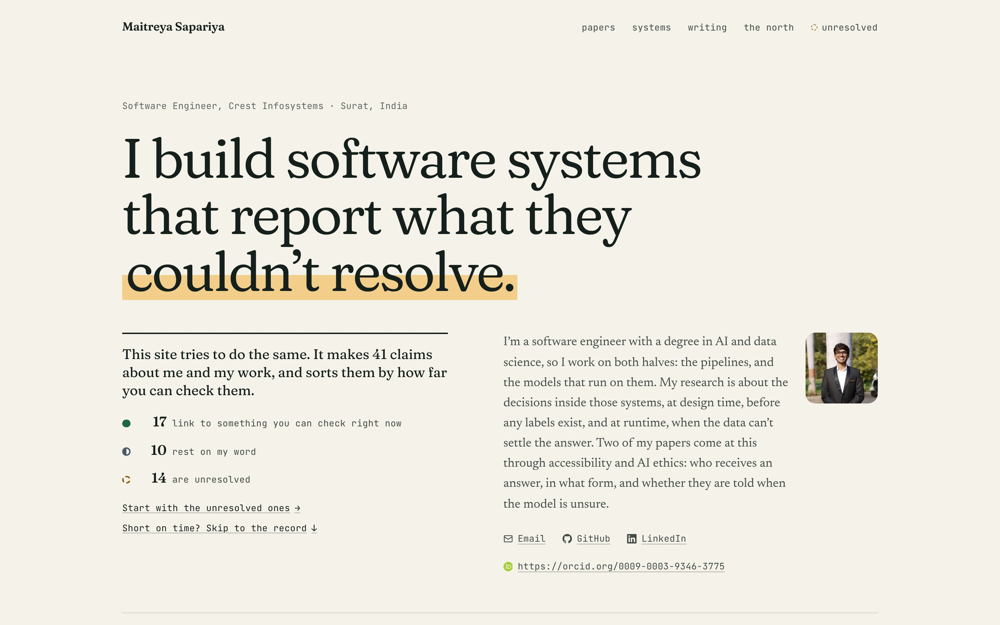

### Added in the last few minutes

You said to improvise, so three design moves went in at the end:

- **Your first draft of the thesis, crossed out above the new one**, with a
  red note: "first draft. It described a job." It is the site's own gesture
  turned on its own headline. The old sentence is yours (it is quoted in
  `CLAUDE.md`); the note is mine. If showing the discarded line feels like
  too much, delete the `thesis-was` paragraph in `src/pages/index.astro`.
- **The three lamps sit in a housing**, so the mother's screen reads as a
  signal and not three circles.
- **A closing band**, the one place the page inverts: "13 things on this
  site are still unresolved." The number is counted, not typed.

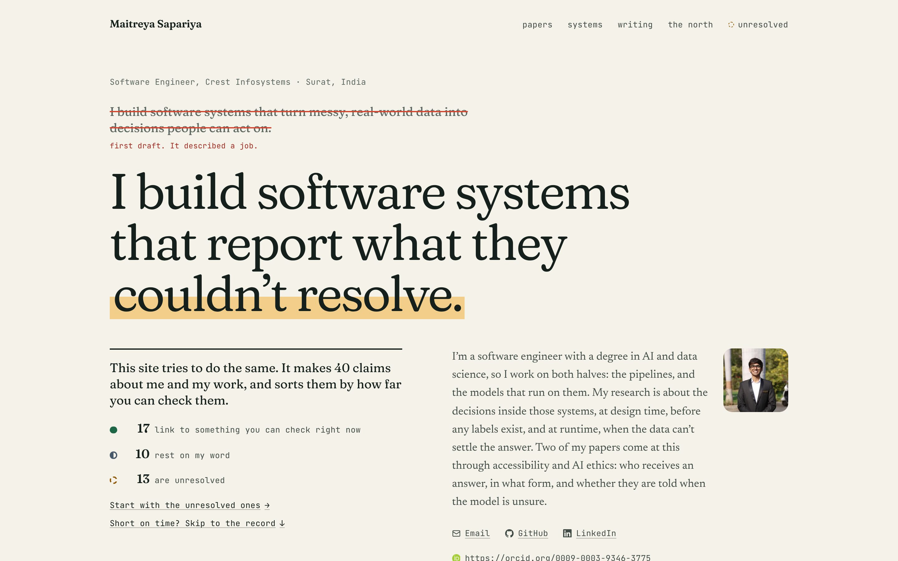
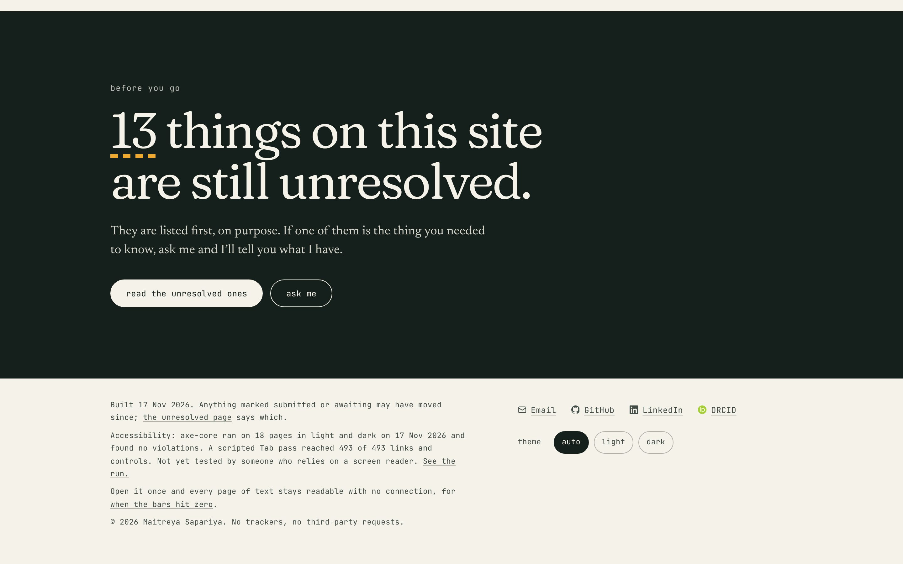

---

## What I saw

I read the four posts and the nine stop notes first, as you asked, then the
papers, the case studies, both specs and the git log.

Three things stood out.

**1. The thread is stronger than the site let on.** The phase 11 spec has a
table that names it. But on the page, the thread was one italic sentence
under your name, and then a list of citations. The most interesting facts
about you were the ones buried deepest: that you reported 0.580 when 0.859
was sitting right there, that your pre-registration lists its own
deviations, that your case study ends by criticising your own build, that
CARTA claims no accuracy number. A professor skimming the old home page saw
none of that. They saw a competent junior researcher with four papers.

**2. The honest caveats were scattered, so they read as fine print.** Each
one sat at the bottom of its own page. Collected in one place and put
first, they stop being disclaimers and become the argument. Very few
applicants have a page listing what is wrong with their own work. I think
that page is the thing a professor remembers the next morning.

**3. Your voice was only in `/writing`.** "A coin flip with extra steps."
"I would take an honest 0.580 over a shiny 0.859." Those lines were two
clicks down. The home page sounded like a careful stranger.

One more, smaller. The trip is the same instinct pointed at yourself. "I
understood maybe forty percent of each lecture" is an honest number of
exactly the kind your papers report. That is why I think it belongs in the
same world as the research and not in a separate room.

---

## Your questions

**Is the academic homepage the right genre, or the safe one?**
It is the right *reference* and the wrong *opening*. So it is still here, as
a section called "The record" two-thirds of the way down, with a link from
the top for the reader in a hurry ("Short on time? Skip to the record").
But the page now opens with an argument. The genre I landed on is closer to
a paper than a profile: a claim, the evidence, the limits, then the
references.

**Could the site behave honestly, not only describe it?** Yes, and this is
most of what I built:

- The ledger and its three states.
- Visible TODOs in the unresolved colour.
- The footer's accessibility sentence is no longer typed by anyone. A script
  runs axe-core and a keyboard pass, writes a JSON file, and the footer
  prints what is in it. If the run fails, the footer says so.
- The footer gives the build date and warns that "submitted" and "awaiting"
  go stale.
- The 404 page: "This address couldn't be resolved. No guess at what you
  meant."
- Offline, a bar across the top: "Couldn't reach the network. You're reading
  the copy your browser saved."
- The demo says, inside itself, which of its numbers is real and which is a
  stand-in.

**One world or separate rooms?** One world. The six cards on the home page
are a journal paper, a preprint, a submitted paper, a production system and
an internship, and they sit in one grid because they are the same habit.
The trip joins them through the 40%.

**Accessibility as the point, and ambitious?** What I did:

- A real dark theme, following the system, with a switch in the footer.
- `prefers-contrast: more` folds the faint text tier into the darker one.
- `prefers-reduced-motion` gets no animation at all.
- Windows high-contrast mode is handled (`forced-colors`).
- Colour never carries meaning alone: each state is a shape *and* a word.
  The lamps in the demo say "red: off" in text.
- The demo is a native range input. Arrow keys work, Home and End work, the
  result is announced in a sentence, and with scripts off it shows the one
  real case and hides the slider.
- The audit runs on every page, in both themes, at two widths.

What I did not do is the thing that matters most, and the site says so: no
one who relies on a screen reader has used it.

**Where does the person who wrote "a coin flip with extra steps" show up?**
In his own words, quoted, at display size. I did not try to write jokes for
you. I moved yours to where people will see them.

---

## The tour

### Reported as found

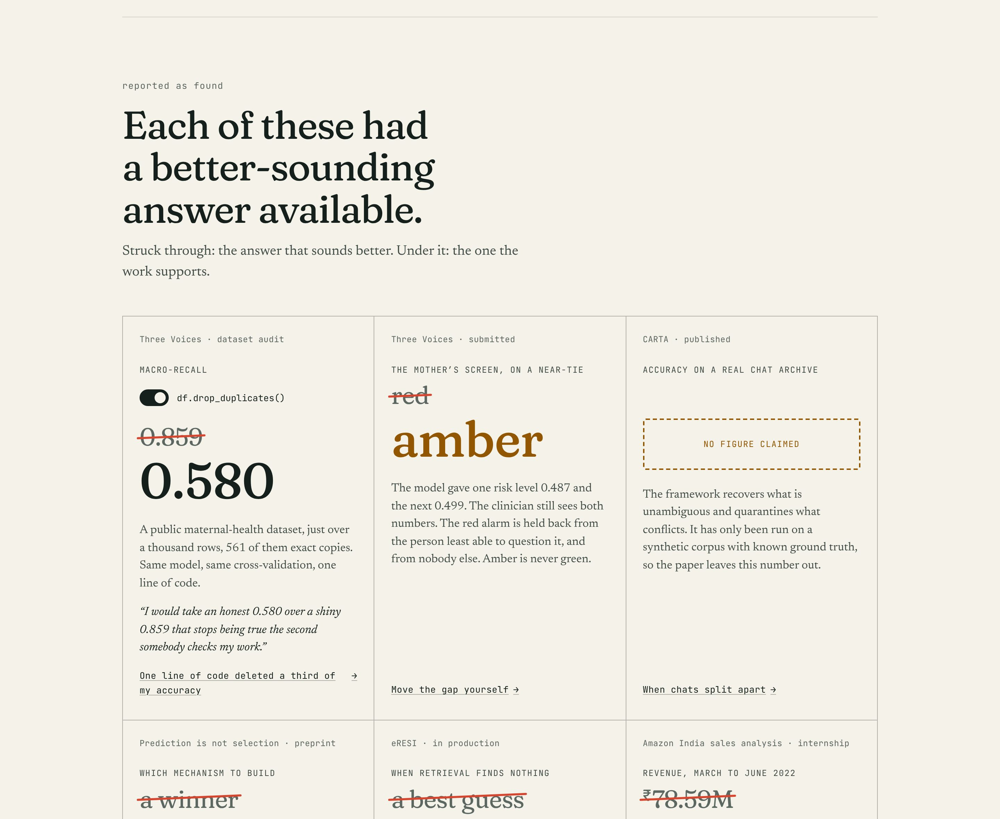

The first card has a switch on `df.drop_duplicates()`. Turn it off and the
numbers swap: 0.859 becomes the big one, and the text explains why that
number is wrong. It is pure CSS, a real checkbox, no script.

### The coin flip

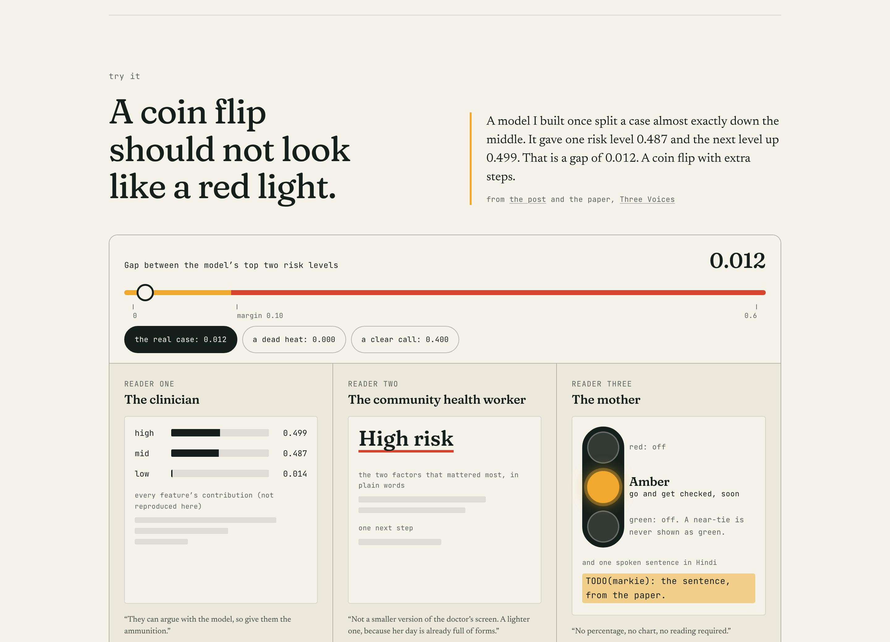
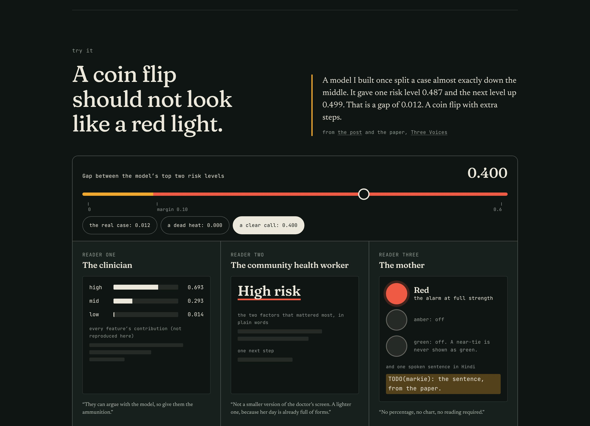

How it works: the two top classes in your real case sum to 0.986. The slider
moves the gap between them along that line, so it passes through 0.487 /
0.499 exactly. Below the margin, the mother's lamp is amber. The clinician
and the health worker see the same thing at every setting, because you
wrote that the alarm is held back "from the person least able to question
it, and from nobody else."

Grey bars stand in for content I don't have (the SHAP breakdown, the card's
wording). I would rather show the *shape* of each reader's screen than
invent what is on it.

### The record

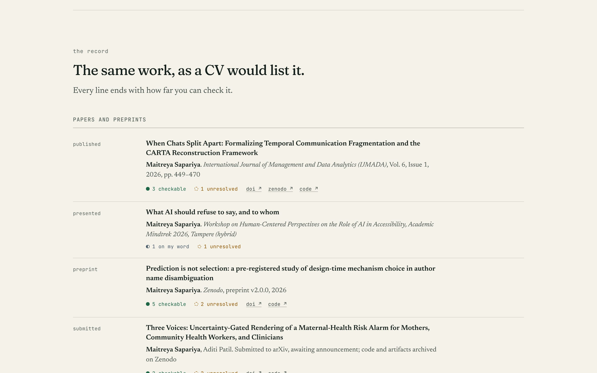

The academic homepage, compressed. Each row ends with its tally from the
ledger and its links.

### /unresolved

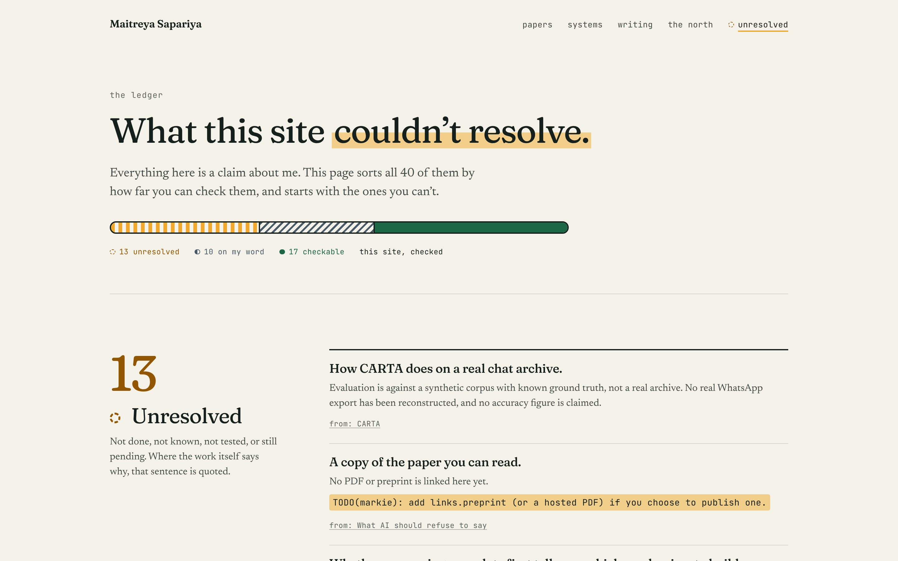

### A paper page

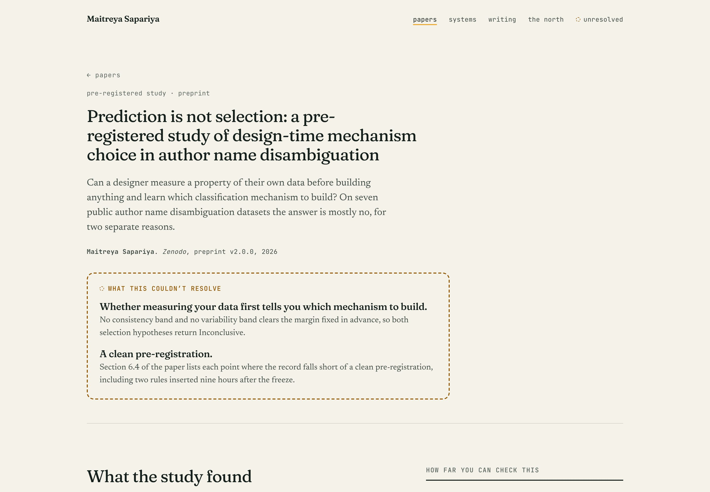

### The north, a post

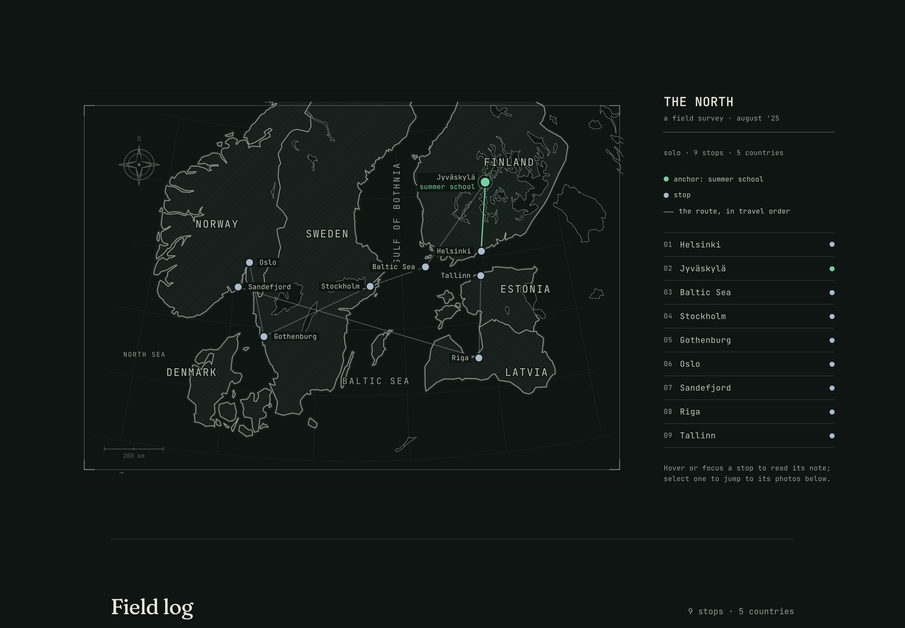
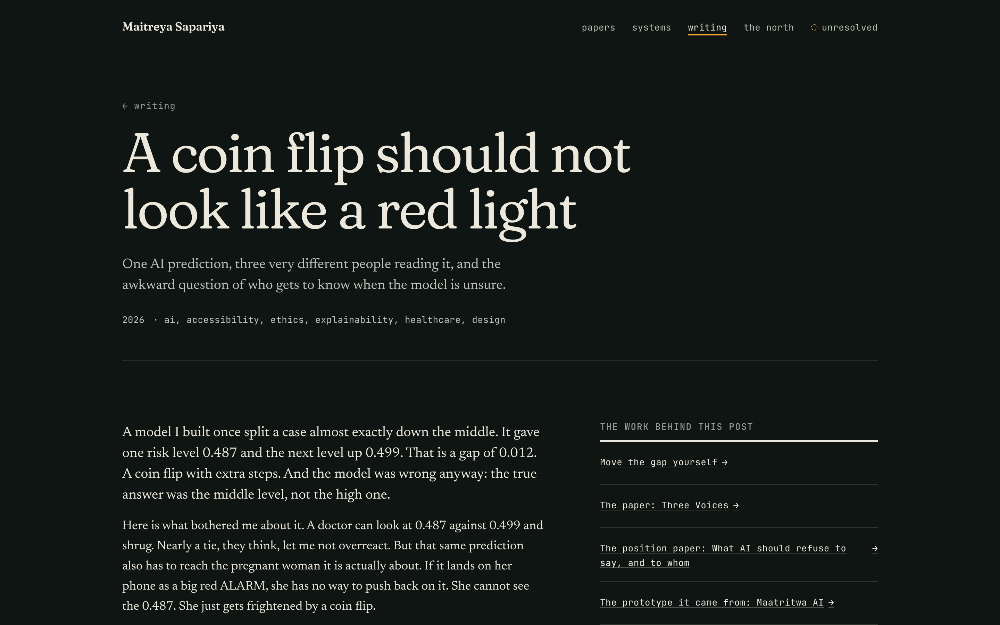

I left the atlas plate alone apart from colours and one bug (below). It was
already the best thing on the site. It looks very good in dark.

### Phone

<p>
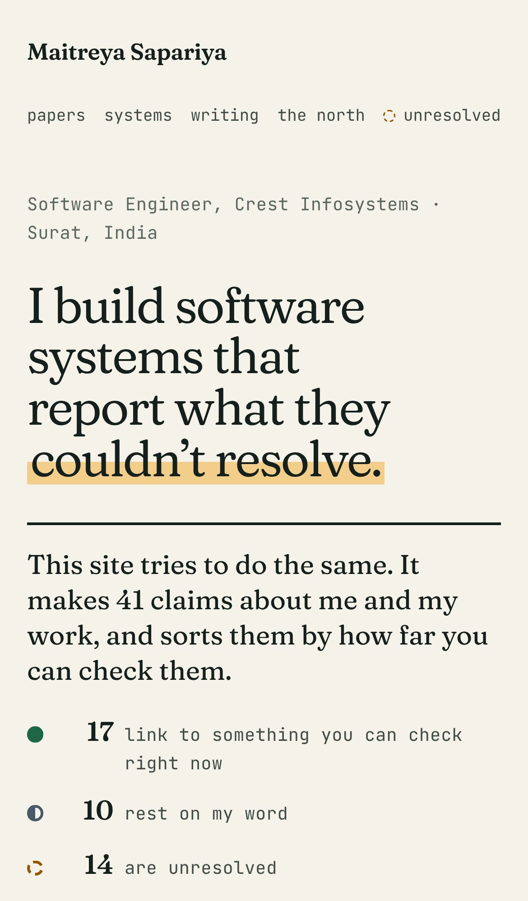
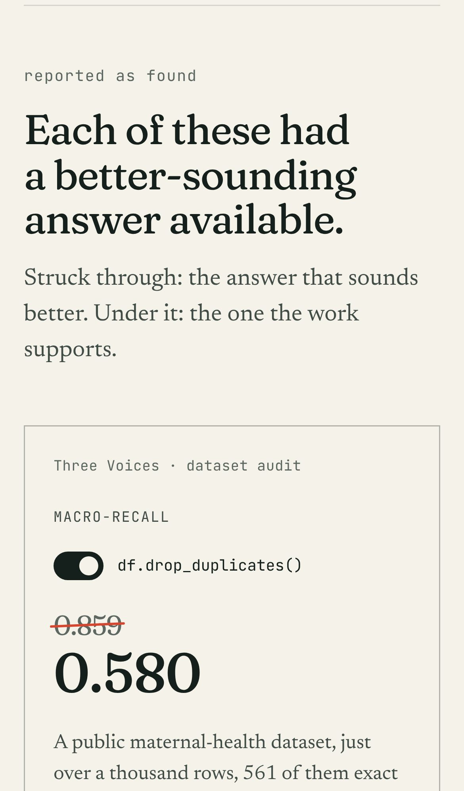
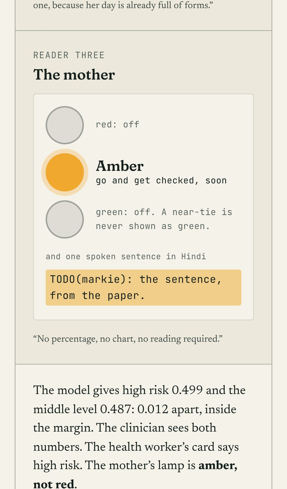
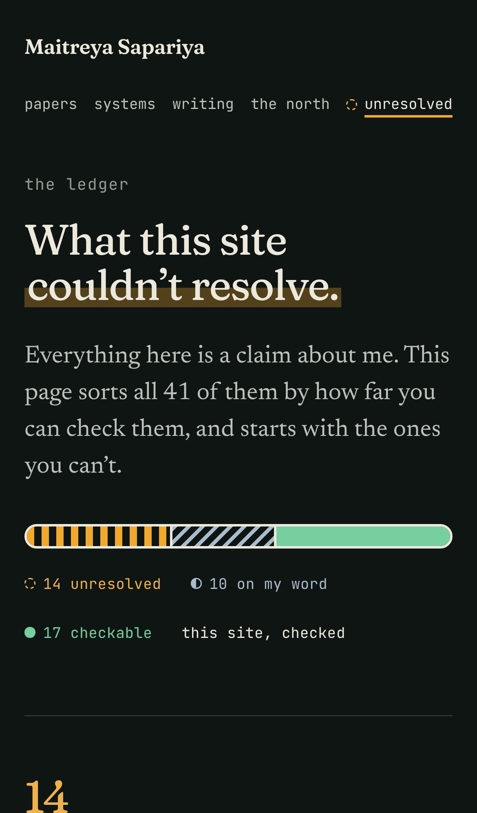
</p>

### Before

<p>
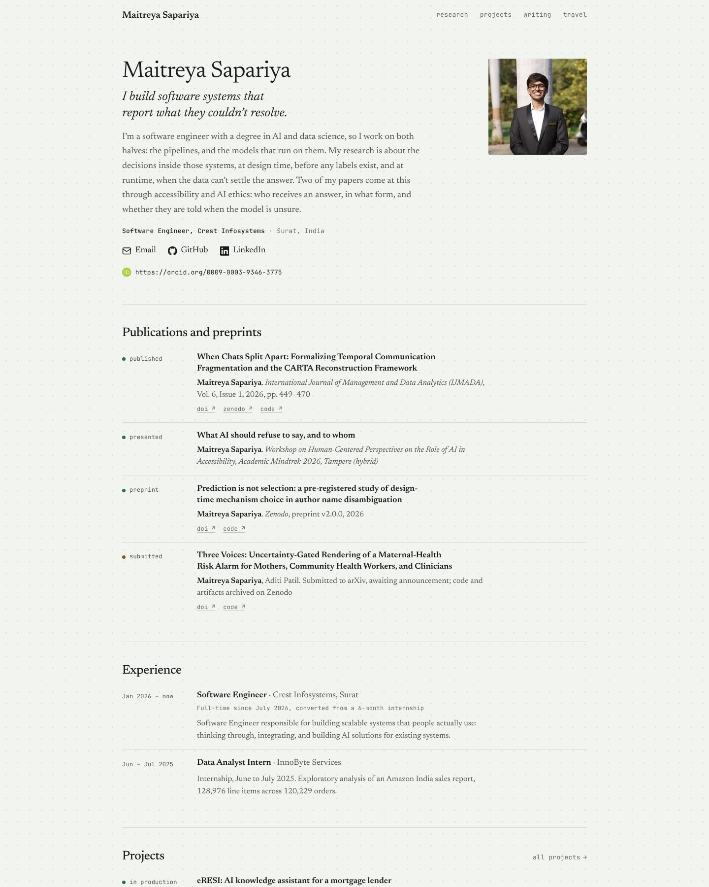
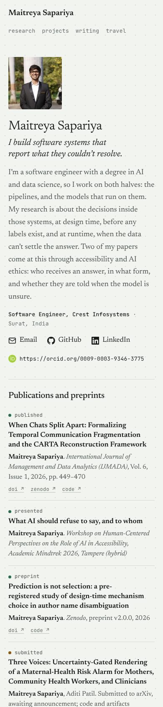
</p>

---

## What I kept, and what I let go

**Kept**

- Your thesis sentence, word for word. I looked for a truer one and didn't
  find it. It is now the largest thing on the site.
- Astro, static output, content collections, one file per piece of work.
- Self-hosted fonts and no third-party requests.
- The margin column. It still says what stage a thing is at; the row now
  also says how far it can be checked.
- The whole `/travel` plate, the field log, and every URL. `/research/*` and
  `/projects/*` did not move, so nothing linked from your CV breaks.
- No em dashes, and no words from the banned list. They were good rules.
- "Never guess at a fact." The strictest rule in `CLAUDE.md`, and the one I
  leaned on hardest.

**Let go**

- The home page as a list of lists.
- One hue. There are now four, because your research has three lamps:
  green, amber, red, plus slate. Amber is the lead colour. It is the colour
  of "not sure, go and check", which is your subject.
- Two typefaces. Fraunces is the third, for display. It is warm and a little
  sturdy, and it is what makes the site sound less careful.
- "No client JS." Three small scripts are new: the demo, the theme switch,
  and the offline worker. Each one degrades to a working page without it.
- "No box-shadow, no gradient." There is a lamp glow and a highlighter mark.
- The nav labels. Research is "papers", projects is "systems", travel is
  "the north". Easy to change back in `Nav.astro`.
- The status dots. The three marks replace them.

---

## Words: yours and mine

**Yours, untouched:** the thesis, the bio, every post, every stop note, every
paper and project body, the ledes on `/research`, `/projects`, `/writing`
and `/travel`.

**Yours, quoted:** every line in quotation marks on the home page and in the
demo is lifted verbatim from a post. Most `note:` lines in the ledgers are
your sentences from the paper page or case study.

**Mine, waiting on you.** Search the source for `drafted by Fable`. The list:

| Where | What |
| --- | --- |
| Home, above the thesis | The note "first draft. It described a job." |
| Home, under the thesis | "This site tries to do the same. It makes N claims…" and the three tally lines |
| Home, the closing band | "N things on this site are still unresolved…" and the line under it |
| Home, "reported as found" | The heading, the lede, and the body text of the six cards |
| Home, the record | "The same work, as a CV would list it." |
| Home, writing | "Where I sound like myself." |
| Home, the north | The last paragraph ("It is the same habit as the rest of this page, turned on myself…") |
| The demo | Labels, the live sentence, the three fine-print notes |
| Every paper and project | The `ledger:` block in the frontmatter (the `claim:` lines are mine; most `note:` lines are yours) |
| `/unresolved` | All of it, including "How it is made" |
| Footer, 404, offline bar | All of it |

One edit inside a file of yours: `finland-couldnt-define.md` had two image
slots you had marked with comments. I mounted the lecture-hall photo and
the cohort selfie there. Your blueberry slot is still empty, because the
only berry photo in the repo is a market stall and the sentence is about a
forest.

---

## Facts I didn't have

Each of these is on the live page as an amber `TODO(markie)`. **Please clear
them before anything reaches `main`**, either by filling them in or by
deleting the line.

```bash
grep -rn "todo:\|Todo text=\|HINDI_SENTENCE = ''\|const MARGIN" src
```

1. **The margin in Three Voices.** The demo uses 0.10 as a stand-in and says
   so. Set `MARGIN` in `src/components/CoinFlip.astro`.
2. **The spoken Hindi sentence.** Set `HINDI_SENTENCE` in the same file. When
   it is not empty, a "hear it" button appears and the browser speaks it
   with its own Hindi voice. If the browser has none, the page says that.
3. **arXiv link** for Three Voices, once announced.
4. **Mindtrek:** a link to the workshop programme or acceptance, and a PDF if
   you want one public.
5. **AWS certifications:** the Credly or AWS verification links. Right now
   they are "on my word".
6. **Your degree:** a redacted certificate, if you want that line checkable.
7. **DataSaarthi:** one or two lines on where it falls short. It is the only
   piece of work with nothing in its "couldn't resolve" box, and the page
   says so.

Two things I assumed, which you should check:

- In the demo the health worker's card reads "High risk" at every setting. I
  took that from "and from nobody else". If the card also changes on a
  near-tie, the demo is wrong.
- The "low" bar shows 0.014. That is 1 − 0.487 − 0.499, on the assumption
  that there are exactly three classes.

---

## Things I found along the way

- **The old footer's claim was not quite true.** It said "Accessibility
  checked with axe-core". The first run of the new audit found a violation
  on `/travel` that was already on `main`: the Jyväskylä marker's label did
  not contain its visible text ("summer school"). Fixed.
- **The audit then caught me.** My own results table scrolled sideways on a
  phone with no keyboard access. Fixed. I mention it because it is the
  system working.
- **Ten type errors on `main`**, all in the travel map's inline script.
  `astro check` now reports none.
- **Tap targets on the map at phone width.** Oslo and Sandefjord, and
  Helsinki and Tallinn, sit closer than a fingertip. This is on `main` too,
  and Lighthouse scored `/travel` 96 for accessibility because of it. On a
  phone the markers are no longer tap targets; the stop index under the map
  (one full-width row per stop) links to the same places. `/travel` now
  scores 100.

---

## What I checked, and what I didn't

| Check | Result |
| --- | --- |
| `npm run build` | 19 pages |
| `npx astro check` | 0 errors (needs `@astrojs/check` and `typescript`, which I installed without saving) |
| `npm run audit` (axe-core 4.14.1) | 18 pages × light and dark × 1280 px and 390 px: **0 violations** |
| Scripted Tab pass | reached 491 of 491 links and controls |
| `npm run contrast` | every text colour ≥ 4.5:1 on both papers, both themes |
| Demo, by keyboard | amber up to 0.098, red from 0.100; Home, End and the three buttons work |
| Scripts off | slider hidden, real case shown, theme switch hidden |
| Offline | after one visit, four other pages loaded with fonts and showed the notice |

Lighthouse, mobile emulation, against a local preview server. I built `main`
the same way to compare:

| Page | Performance (main → branch) | A11y | Best practices | SEO |
| --- | --- | --- | --- | --- |
| `/` | 98 → 97 | 100 | 100 | 100 |
| `/research/three-voices` | 100 → 99 | 100 | 100 | 100 |
| `/travel` | 97 → 96 | 96 → 100 | 100 | 100 |
| `/unresolved` | new: 100 | 100 | 100 | 100 |

My first pass scored 82 on the home page. A single rupee sign was pulling in
a second 103 KB font file, and the stylesheet was a blocking request.

**Not checked:**

- **Only Chromium.** Not Firefox, not Safari, not a real phone. The switch on
  the first card uses `:has()`, the lamp glow uses `color-mix()`, and the
  strike draws in on scroll with `animation-timeline`. All three fall back
  to something sensible in theory. I have not seen it.
- **No screen reader.** The markup is built for one. Nobody has listened to it.
- **Lighthouse on Vercel.** These are local numbers.
- **The external links.** I copied them from your files and did not fetch them.

---

## Decisions that are yours

1. **"On my word" next to your degree and your job.** I think it reads as
   rare candour, and it is literally true of every CV. But it is your name.
   If it reads as doubt to you, the fix is a link, and the line turns green.
2. **The AI disclosure on `/unresolved`.** It says you build the site with
   Claude under your direction, as the pre-registered study disclosed. I
   wrote it because it matches what you already do in public. Keep it, cut
   it or reword it.
3. **The offline worker.** It came from the last line of your Faraday post.
   It is careful (pages are always fetched fresh when you are online), but a
   service worker is the one piece that outlives a deploy. The comment at
   the top of `src/pages/sw.js.ts` says how to switch it off.
4. **The count on the home page.** "13 are unresolved" is the hook. Two of
   the thirteen are about the site itself, not about you. If that feels like
   padding, move them out of `siteItems()` in `src/ledger.ts`.
5. **`CLAUDE.md`.** I added a six-line note at the top and changed nothing
   else. If you keep this branch, the design law, the checklist and the
   "no agent writes prose" line all need rewriting. That file is yours.

---

## With another day

- **Get it in front of someone who uses a screen reader.** Then write what
  they say on `/unresolved`.
- **Let the ledger check itself.** A nightly job that fetches every
  "checkable" link and, if one is dead, moves that claim to "unresolved" on
  its own. The site would then report what it couldn't resolve without
  anyone telling it to.
- **Make CARTA playable.** Two phones, one account, a history that splits,
  and a reader watching what gets recovered and what gets quarantined. It
  is your published paper and it is the only one shown as an empty box. I
  did not build it because I would have had to guess what "conflict" means
  in the paper, and a wrong picture of a journal article is exactly the
  kind of thing a professor checks.
- **Give each claim a date.** "As of 12 November" beside every status, from
  git history, so staleness is visible per line.
- **Test in Firefox and Safari** and on a slow phone.
- **A second plain-language post**, for *Prediction is not selection*. It is
  the paper with the best story (the nine-hour rule, the cold re-run on a
  two-core laptop) and no post tells it. That one is yours to write.

---

## How it is put together

| File | What it does |
| --- | --- |
| `src/content.config.ts` | Adds `ledger`, `kind` and `related` to papers and projects |
| `src/ledger.ts` | Gathers every claim; `tally()` gives the counts |
| `src/site.config.ts` | Study and work; a `todo` on any line without proof |
| `src/components/State.astro`, `Todo.astro`, `LedgerList.astro` | The three marks, the visible TODO, a list of claims |
| `src/components/WorkPage.astro` | Paper and system pages: limits first, then the write-up beside its ledger |
| `src/components/CoinFlip.astro` | The demo and its script |
| `src/pages/unresolved.astro` | The whole ledger, and the site's report on itself |
| `src/pages/sw.js.ts` | The offline worker, generated at build |
| `src/data/a11y-audit.json`, `audit.ts` | The last audit run, typed |
| `scripts/audit.mjs`, `contrast.mjs`, `og-image.mjs` | The checks, and the share card |
| `src/styles/global.css`, `travel.css` | New tokens, light and dark; the travel plate's styles moved to their own file |

To move a claim from "on my word" to "checkable", give it a link. That is the
whole mechanism.

---

The work was already saying this. I only moved it to where people can see it.

Fable

---

## After Fable's run

*Added 17 November 2026 by Claude, at Maitreya's request. Fable's notes above
are unchanged.*

**`/unresolved` is retired.** It gathered every claim on the site into one
list, unresolved first, with the accessibility run and a note on how the site
is made. Maitreya decided it should not be there. Everything that led to it
now points somewhere that exists:

| Where | Before | Now |
| --- | --- | --- |
| Nav | an "unresolved" link | gone |
| Home, under the tally | "Start with the unresolved ones" and "Short on time? Skip to the record" | one link: "See each one in the record" (every row there shows its own count) |
| Home, closing band | "They are listed first, on purpose." Buttons: read the unresolved ones, ask me | "Each paper and system lists its own first, on purpose." Buttons: ask me, back to the record |
| Footer | linked to the page and to the audit table | the computed accessibility sentence stays; no links |
| 404 | "see what else is unresolved" | "see the papers" |
| Paper and system pages | "the whole ledger" link under each ledger | gone; the "What this couldn't resolve" box and the ledger stay |
| Sitemap, offline worker | listed the page | no longer list it |

The tally on the home page now counts the work only. The page's three claims
about the site itself (the audit run, the untested screen-reader experience,
the demo's stand-in margin) had nowhere else to be listed, so they left the
count: **37 claims, 16 checkable, 10 on Maitreya's word, 11 unresolved**, and
every one can be traced to a row in the record. The audit result and the
screen-reader caveat are still in the footer; the stand-in margin is still
stated inside the demo.

Gone with the page, and not moved anywhere: the per-page audit table, the
list of what the site does without being asked (themes, reduced motion,
contrast, offline), and the AI-assistance disclosure. Any of them can come
back into the footer if wanted.

**`TODO(markie)` notes are development-only.** All nine still render in
`npm run dev`. A production build leaves them out (`src/todo.ts`), so the
live site never shows one; the claim beside each still shows its honest
state. Where a note stood in for content (the mother's spoken sentence), the
demo shows the same "not reproduced here" placeholder the other two readers'
screens use.

**Checked after these changes:** build and type check clean; a link check
over the build finds no broken internal links or anchors; axe-core on the 17
remaining pages in light and dark at two widths finds no violations, the Tab
pass reaches 351 of 351 links and controls, and the 404 page also passes
axe; local Lighthouse on `/` scores 97 for performance and 100 for
accessibility, best practices and SEO.

The screenshots in `docs/fable/` show the site as Fable left it.

**Later the same day: the rules caught up.** Maitreya approved a new
`CLAUDE.md` describing the site as it now is (Fable's branch note is gone
with the old one), and `AGENTS.md` was brought in line. Checking that draft
against the font files found the three gaps it then listed, all fixed:

- `→`, `←` and `↗` were in none of the self-hosted font files, so every
  typed arrow (the link glide, back links, external-link marks) rendered
  from a system font; this was true on `main` too. They are now drawn
  shapes, masked in the current text colour. The Baltic Sea stop's
  "Helsinki → Stockholm" now reads "Helsinki to Stockholm".
- Two literal colours in component rules are tokens (`--housing-ring`,
  `--on-amber`), and `npm run contrast` now checks text set on a fill.
- The unused `--shadow` token is gone.

**Later still: the claim ledger is retired.** Seeing the preview, Maitreya
decided it did not belong: "This is portfolio website, not a court hearing
where you need to prove every word you write or speak. And it is well
understood that you just cannot put proof claim of everything. And marking
them unresolved is ridiculous." So nothing on the site labels a claim by how
provable it is any more: the home tally, the closing band, the per-row
counts, the "What this couldn't resolve" boxes, the state marks (in the demo,
the 404, the offline notice) and the dashed-ring favicon are all gone, and
`CLAUDE.md` now makes that a content rule. The struck-through findings, the
coin flip and the record stay. Paper and system pages list their links under
a plain Sources heading.

The "no figure claimed" box on CARTA's card became the paper's Fig. 1,
redrawn in the site's colours, beside a line from the paper's introduction.
The paper's page now carries its Fig. 1 and Fig. 2, cropped from the
published PDF Maitreya shared, with the paper's own captions. The favicon is
an M over the amber highlighter.

The screenshots in `docs/fable/` still show the site as Fable left it.

**And a last pass on the opening.** The crossed-out first draft above the
thesis is gone ("not needed at all"); the role line became three labelled
fields under one rule (currently, at, based in); and the record's heading
is now "Papers, systems, work and study." After the merge, the portrait
left its thumbnail beside the bio for its own column beside the thesis (a
wide crop between the thesis and the bio on a phone).
